<div align="center">



<br/>

<!-- Typing animation -->


<br/><br/>

<!-- ─────────────────── about ─────────────────── -->


<br/>

```
  studying ai & data engineering · building things with python, php & sql
  endlessly curious about how data tells stories · fuelled by coffee & playlists
```

<br/>

<!-- ─────────────────── divider ─────────────────── -->


<br/>

<!-- ─────────────────── tech stack ─────────────────── -->

**`✿  my stack  ✿`**

<br/>


&nbsp;

&nbsp;

&nbsp;

&nbsp;

&nbsp;


<br/><br/>

<!-- ─────────────────── divider ─────────────────── -->


<br/>

<!-- ─────────────────── cat + snake ─────────────────── -->

**`♡  activity  ♡`**

<br/>

<table border="0" cellspacing="0" cellpadding="0">
<tr>
<td valign="middle" align="center" width="120">


</td>
<td valign="middle" align="center">

<!-- Snake animation — generated by GitHub Actions into the 'output' branch -->
<picture>
  <source media="(prefers-color-scheme: dark)"
          srcset="https://raw.githubusercontent.com/burcuyldrm/burcuyldrm/output/snake-dark.svg"/>
  <source media="(prefers-color-scheme: light)"
          srcset="https://raw.githubusercontent.com/burcuyldrm/burcuyldrm/output/snake.svg"/>
  
</picture>

</td>
</tr>
</table>

<br/>

<!-- ─────────────────── divider ─────────────────── -->


<br/>

<!-- ─────────────────── find me ─────────────────── -->

**`✦  find me  ✦`**

<br/>

<a href="https://www.linkedin.com/in/burcuyldrm">
  
</a>

<br/><br/>


<br/><br/>

</div>
